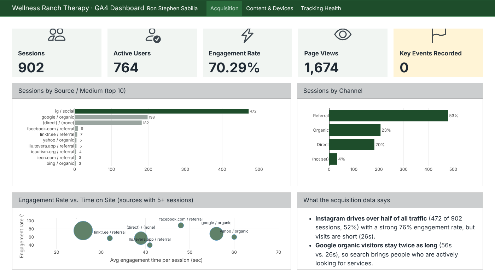

## About This Dashboard

This dashboard tracks website performance for our CEP client, **Wellness Ranch Therapy**, a nonprofit offering equine-assisted therapy. It uses the client's own **Google Analytics 4** data from the first weeks after tracking went live (Sep 18 – Oct 15, 2026). This is the baseline we'll measure the website redesign and Google Ad Grants campaign against.

::: {.grid}

::: {.g-col-12 .g-col-md-4}
::: {.card-box}
**📈 Acquisition**

Where visitors come from (Instagram, Google, direct) and how engaged each source is.
:::
:::

::: {.g-col-12 .g-col-md-4}
::: {.card-box}
**📄 Content & Devices**

Which pages people view and stay on, plus the mobile vs. desktop split.
:::
:::

::: {.g-col-12 .g-col-md-4}
::: {.card-box}
**✅ Tracking Health**

Which GA4 events and key events are verified, and what's left to set up.
:::
:::

:::

## Key Takeaways

::: {.callout-note}
## At a glance
- **902 sessions** and **764 active users** in the first ~week of tracking
- **Instagram drives 52% of sessions**; Google organic visitors stay the longest (56s)
- **88% of users are on mobile**
- `generate_lead` is now verified in DebugView, so lead tracking is ready for the Ad Grants launch
:::

## Open the Dashboard

<a href="cep-dashboard.html" class="btn btn-primary btn-lg" target="_blank">Launch the full dashboard ↗</a>

<br><br>

[{.border}](cep-dashboard.html){target="_blank"}

*Click the preview or the button to open the interactive version, which has three tabs: Acquisition, Content & Devices, and Tracking Health.*

## How It's Built

The dashboard is a single Quarto file using `format: dashboard`. Rows and columns are set with headings, and each chart is an R code chunk:

```{.yaml filename="cep-dashboard.qmd"}
---
title: "Wellness Ranch Therapy · GA4 Dashboard"
format:
  dashboard:
    orientation: rows
    theme: [cosmo, custom.scss]
---
```

Each `#` heading becomes a **page** (tab), `##` becomes a **row**, and `###` becomes a **column**:

```{.markdown}
# Acquisition                 ← page / tab
## Row {height=18%}           ← KPI value boxes
## Row {height=47%}
### Column {width=60%}        ← sessions by source chart
### Column {width=40%}        ← sessions by channel chart
```

KPIs use `#| content: valuebox`, the charts are interactive **plotly** graphs, and the tracking table is a **DT** datatable. The GA4 numbers are saved as CSV files in the `data/` folder, so the dashboard re-renders with new numbers whenever the CSVs are updated.

Because it lives in the same Quarto project, it shares the site's SCSS theme, so the branding stays consistent.
